  

  
  
  
  

## About me

Software developer from Colombia focused on **backend and process automation**. I work inside an electrical engineering company, replacing work that used to be done by hand (quotes, payroll, supplier invoices, staff compliance) with systems that run on their own. I'm also on the **Advanced Node.js track at [Riwi](https://riwi.io)**.

- 🔭 **Now:** building internal tools that a real team uses every day.
- 🌱 **Learning:** NestJS, clean architecture and testing.
- ⚙️ **How I work:** understand the real process first, build only what's needed, check the results against real data and ship it documented.
- 🎬 **Off the keyboard:** movies, travel and design. Most of my ideas start there.

## Tech stack

**Backend & data** 

**Frontend** 

**Tools & platforms** 

## Systems in production

Built for an electrical engineering company and used every day. The code is private, so here is what each one replaced.

| System | Before → Now | Stack |
|---|---|---|
| **Web quoting app** | Quotes assembled by hand in Excel → one product catalog, salesperson and admin roles, and the official PDF in a couple of clicks | Node.js · Express · PostgreSQL · JWT · pdf-lib |
| **Invoice reader with supervised AI** | Supplier invoices typed into a sheet → read every 15 minutes on a Raspberry Pi 5; AI only for new formats, and nothing gets in until a person approves it | Python · PostgreSQL · Google APIs · Gemini · systemd |
| **Biweekly payroll** | A fragile spreadsheet → payroll for 55 employees, checked against a real pay period within 50 cents | Excel · VBA |
| **Expiration alerts** | Row-by-row manual checks → a daily email before medical exams, contracts or work-at-heights courses expire | Excel · VBA · Task Scheduler |

## Featured projects

| Project | What it does | Stack |
|---|---|---|
| [**Dormify**](https://github.com/leonardo-200224/DORMIFY) | Student housing platform: rentals, a services directory and a community forum | FastAPI · PostgreSQL · SQLAlchemy · JWT |
| [**RiwiMediCare API**](https://github.com/leonardo-200224/-Prueba-M5_2_NodeJS_Final) | REST API that replaces emails and spreadsheets for medicine requests between clinics and warehouses | Express · TypeScript · Sequelize · Swagger |
| [**GestionCall**](https://github.com/leonardo-200224/GestionCall) | Customer management for a call center with case tracking and live statistics | Flask · Chart.js |
| [**TicketSystem SPA**](https://github.com/leonardo-200224/ticket-system-spa) | Support tickets with three roles, persistent sessions and inactivity logout | JavaScript · Vite · Axios |
| [**Reservations API**](https://github.com/leonardo-200224/Actividad_nest_week_5) | The full NestJS request lifecycle: middleware, guard, pipe, interceptor and filters | NestJS · TypeScript |
| [**Rick & Morty SPA**](https://github.com/leonardo-200224/spa-final) | Plain JavaScript SPA with its own router, CRUD and API error handling | JavaScript |

## Portfolio

An interactive portfolio with a 3D scene, **Volt** (a Three.js mascot you can chat with), a working terminal and live data from this GitHub profile.
**[Visit it →](https://leonardo-200224.github.io/portfolio/)** · [Source code](https://github.com/leonardo-200224/portfolio)

## Journey

| When | Milestone |
|---|---|
| **2023 – 2025** | Systems Engineering and first web projects with HTML, CSS, PHP and MySQL |
| **2026 · Riwi** | Python → Frontend → JavaScript & SPAs → Databases → Node.js, TypeScript & NestJS |
| **2026 – now** | Developer at an electrical engineering company, automating real processes |

 <i>Always learning. Always building. Always improving.</i>

